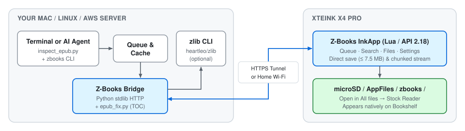

# Z-Books for XTEINK X4 Pro

[](https://github.com/ewijaya/xteink-zbooks/actions/workflows/ci.yml)
[](https://github.com/ewijaya/xteink-zbooks/releases/latest)
[](LICENSE)

An **XTEINK X4 Pro InkApp** (`app_id = "zbooks"`, API 2.18) paired with a zero-dependency Python **Companion Bridge** so you can search & download EPUBs straight to your e-reader over Wi-Fi — or ask an AI agent to find the cleanest retail edition and drop it into your 1-tap reading queue.

<p align="center">
  
</p>

## Highlights

- **On-device Search & Download:** Search EPUBs right from your X4 Pro over Wi-Fi and stream them directly to `microSD/AppFiles/zbooks/`.
- **1-Tap "Send to XTEINK" Queue:** Queue books from your terminal or AI coding agent (`./zbooks queue add` or `./zbooks queue add-file /path/to/book.epub`), then open **Z-Books → Queue** on your X4 Pro and tap **Get** — zero e-ink typing, zero USB cables.
- **Automatic X4 Pro EPUB 3 TOC Fix:** Many retail InDesign/EPUB 3 books put inline HTML (`<span class="TOCNum">1</span>`, `<i class="Italic">Foreword</i>`) inside `<nav>` TOC links, which the X4 Pro stock reader truncates into raw markup. [`server/epub_fix.py`](server/epub_fix.py) automatically flattens `<nav>` TOC anchors into clean plain text while leaving all chapter content, diagrams, CSS, and fonts untouched.
- **Retail EPUB Quality Inspector:** [`tools/inspect_epub.py`](tools/inspect_epub.py) + the bundled agent skill ([`skills/xteink-zbooks/SKILL.md`](skills/xteink-zbooks/SKILL.md)) inspect OPF metadata, publisher, ISBN, reflowable layout, TOC depth, chapter splits, OCR artifacts, and body samples before queuing a book.
- **Direct + Chunked Streaming:** Books ≤ 7.5 MB stream straight to microSD via API 2.18 `save = { to = "files" }`; books > 7.5 MB automatically switch to chunked `ctx.files:append` transfers with a live progress bar.
- **Native Stock Reader:** Exit Z-Books, open **All files → `AppFiles` → `zbooks`**, and tap your `.epub` to read natively (it then appears on your **Bookshelf**).

## How It Works

<p align="center">
  <picture>
    <source media="(prefers-color-scheme: dark)" srcset="docs/assets/architecture-dark.svg" />
    <source media="(prefers-color-scheme: light)" srcset="docs/assets/architecture-light.svg" />
    
  </picture>
</p>

*Why a companion bridge?* Stock InkApps run in a ~1 MB Lua sandbox with no automatic HTTP redirects and a 128 KB response limit (unless streaming directly to a file). Keeping search, auth cookies, mirror handling, caching, and EPUB TOC cleaning on the bridge makes the X4 Pro app fast, tiny (`57 KB`), and easy to maintain without rebuilding `.xtapp` packages.

## Quick Start

Full guide: **[docs/SETUP.md](docs/SETUP.md)**

### 1. Download the InkApp
Grab `zbooks-0.1.1.xtapp` from the **[latest GitHub Release](https://github.com/ewijaya/xteink-zbooks/releases/latest)** (or build from source with `make package`).

### 2. Start the Bridge (Zero pip Dependencies)

**Home Wi-Fi / Mac LAN (no tunnel needed):**
```bash
git clone https://github.com/ewijaya/xteink-zbooks.git
cd xteink-zbooks
./zbooks init --url http://<YOUR-MAC-OR-PC-IP>:8742
./zbooks serve --host 0.0.0.0 --port 8742
```

**Or anywhere over HTTPS (Cloudflare Tunnel):**
```bash
./zbooks init --url https://<YOUR-TUNNEL-URL>
./zbooks serve
# In another terminal (or systemd): cloudflared tunnel --url http://127.0.0.1:8742
```

*(For Z-Library search, install [`heartleo/zlib`](https://github.com/heartleo/zlib) and run `zlib login` in your own terminal. For local EPUBs only, `zlib` is not required.)*

### 3. Install on Your XTEINK X4 Pro
1. Put your X4 Pro in **USB Mode**.
2. Copy `zbooks-0.1.1.xtapp` to the microSD root.
3. Save the `config.json` printed by `./zbooks init` into `microSD/AppFiles/zbooks/config.json`:
   ```json
   {
     "url": "https://your-bridge-url",
     "token": "YOUR_GENERATED_TOKEN"
   }
   ```
4. Eject safely → open **All files** → tap `zbooks-0.1.1.xtapp` → **Install** → launch **Ink App → Z-Books** → tap **Set → Test Connection**.

### 4. Queue Books from Terminal or AI Agent
```bash
# Search Z-Library
./zbooks search "The Art of Doing Science and Engineering"

# Inspect an EPUB's retail quality & X4 Pro readability
python3 tools/inspect_epub.py path/to/book.epub

# Queue a Z-Library book (--prefetch caches it immediately)
./zbooks queue add 21837572:2a66c7 --title "The Art of Doing Science and Engineering" --author "Richard W. Hamming" --prefetch

# Queue any personal/local EPUB on your computer or server
./zbooks queue add-file /path/to/my-book.epub
```

## Project Layout

```text
xteink-zbooks/
├── app/                   # X4 Pro InkApp (Lua 5.5, API 2.18, 480x800 portrait)
├── server/                # Zero-dependency Python HTTP bridge, EPUB TOC cleaner & CLI
├── zbooks                 # Executable CLI wrapper (init, serve, search, queue)
├── tools/                 # Icon generator, EPUB inspector, linter, Lua tests, .xtapp packager
├── dist/                  # Built zbooks-0.1.1.xtapp + SHA256SUMS
├── docs/                  # Setup guide, screenshots, systemd service templates
└── skills/xteink-zbooks/  # Agent skill for finding, verifying, and queuing books to X4 Pro
```

## Prerequisites & Build

- **Device:** XTEINK X4 Pro on stock XTOS Licorice (InkApp API 2.18, verified on `26112001`).
- **Running the bridge:** Python 3.10+ (stdlib only).
- **Building `.xtapp` from source:** Python 3.10+, `Pillow`, `cryptography`, and Lua 5.5 (`make test`, `make package`).

## Note

Z-Books works with both your own local `.epub` files (`queue add-file`) and optionally with [`heartleo/zlib`](https://github.com/heartleo/zlib). Users are responsible for complying with applicable copyright laws and terms of service in their jurisdiction.

## License

MIT — see [LICENSE](LICENSE). Vendored packaging and lint tools under `tools/vendor/` retain their respective licenses.
